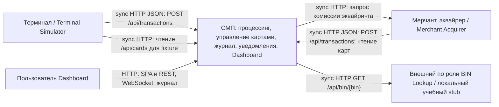

# А1. C4 Context — граница процессингового ядра

**Чего не хватало:** отдельной границы СМП и протоколов внешних участников.
**Что сделано:** выделено процессинговое ядро с Dashboard; симуляторы и BIN Lookup
показаны внешними по ответственности, хотя в учебном стенде развёрнуты тем же Compose.
Это логическая C4-схема в нотации Mermaid flowchart.

## Подтверждение кодом

- [GatewayClient.java](../../../services/terminal-simulator/src/main/java/com/processing/terminalsimulator/client/GatewayClient.java) — отправка транзакций и прямое чтение карт CMS.
- [GatewayClient.java](../../../services/merchant-acquirer/src/main/java/com/processing/merchantacquirer/client/GatewayClient.java) — транзакции и чтение карт через Gateway.
- [MerchantAcquirerClient.java](../../../services/switch/src/main/java/com/processing/service/MerchantAcquirerClient.java) — обратный HTTP-запрос комиссии из Switch.
- [nginx.conf](../../../services/dashboard/nginx.conf) и [useWebSocket.ts](../../../services/dashboard/src/hooks/useWebSocket.ts) — SPA/API proxy и `/ws/transactions`.
- [BinLookupClient.java](../../../services/authorization/src/main/java/com/processing/authorization/client/BinLookupClient.java) и [BinLookupController.java](../../../services/bin-lookup/src/main/java/com/processing/binlookup/controller/BinLookupController.java) — HTTP lookup; на стенде это локальная статическая таблица, обращения в настоящий банковский интернет-сервис нет.
- [docker-compose.yaml](../../../docker-compose.yaml) — физическое развёртывание всех участников.

Терминальный протокол здесь — HTTP JSON с ISO-подобными полями, а не бинарный ISO 8583 поверх TCP.
Для E2E граница расширяется до учебных симуляторов; BIN можно заменить контролируемым stub.
