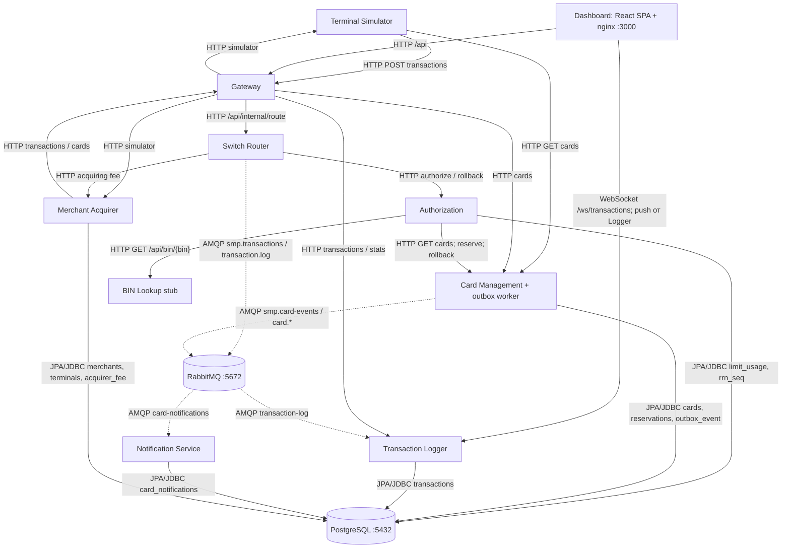

# А2. C4 Container — фактический состав стенда

**Чего не хватало:** проверенной по Compose схемы с sync/async, outbox и комиссией.
**Что сделано:** показаны все 10 прикладных контейнеров, две инфраструктурные зависимости,
пути данных и отдельная WebSocket-связь. HTTP/JDBC — сплошные линии; AMQP — пунктир.

## Сверка и источники

- [docker-compose.yaml](../../../docker-compose.yaml): девять Java-контейнеров используют внутренний HTTP-порт 8080;
  Dashboard — 3000. Порты хоста берутся из переменных Compose, `.env` не читался.
  PostgreSQL и RabbitMQ не входят в число прикладных сервисов.
- [application.yml](../../../services/gateway/src/main/resources/application.yml) — HTTP routes; [nginx.conf](../../../services/dashboard/nginx.conf) — API/WS proxy.
- [RouteService.java](../../../services/switch/src/main/java/com/processing/service/RouteService.java), [AuthorizationClient.java](../../../services/switch/src/main/java/com/processing/service/AuthorizationClient.java), [MerchantAcquirerClient.java](../../../services/switch/src/main/java/com/processing/service/MerchantAcquirerClient.java), [CardManagementClientImpl.java](../../../services/authorization/src/main/java/com/processing/authorization/client/CardManagementClientImpl.java), [BinLookupClient.java](../../../services/authorization/src/main/java/com/processing/authorization/client/BinLookupClient.java) — HTTP зависимости ядра.
- [GatewayClient.java](../../../services/terminal-simulator/src/main/java/com/processing/terminalsimulator/client/GatewayClient.java), [GatewayClient.java](../../../services/merchant-acquirer/src/main/java/com/processing/merchantacquirer/client/GatewayClient.java) — входные генераторы.
- [LoggerClient.java](../../../services/switch/src/main/java/com/processing/service/LoggerClient.java), [OutboxEventProcessorImpl.java](../../../services/card-management/src/main/java/com/processing/cardmanagement/services/OutboxEventProcessorImpl.java), [TransactionLogListener.java](../../../services/transaction-logger/src/main/java/com/processing/transactionlogger/listener/TransactionLogListener.java), [CardEventListener.java](../../../services/notification-service/src/main/java/com/processing/notification/listener/CardEventListener.java) — AMQP связи.
- [LimitUsageRepository.java](../../../services/authorization/src/main/java/com/processing/authorization/repositories/LimitUsageRepository.java), [CardJpaRepository.java](../../../services/card-management/src/main/java/com/processing/cardmanagement/repositories/CardJpaRepository.java), [TransactionRepository.java](../../../services/transaction-logger/src/main/java/com/processing/transactionlogger/repository/TransactionRepository.java), [CardNotificationRepository.java](../../../services/notification-service/src/main/java/com/processing/notification/repository/CardNotificationRepository.java), [MerchantRepository.java](../../../services/merchant-acquirer/src/main/java/com/processing/merchantacquirer/repository/MerchantRepository.java), [TerminalRepository.java](../../../services/merchant-acquirer/src/main/java/com/processing/merchantacquirer/repository/TerminalRepository.java), [AcquirerFeeRepository.java](../../../services/merchant-acquirer/src/main/java/com/processing/merchantacquirer/repository/AcquirerFeeRepository.java) — пять владельцев доступа к БД.

Health-check, Swagger и технические метрики не показаны как бизнес-связи.
Профиль observability добавляет Prometheus, Grafana, Loki, Promtail и autoscaler;
это не недостающий «11-й» прикладной сервис. Publisher confirms включены в конфиге Switch,
но ожидание подтверждения кодом не реализовано (D2). Топология раскрыта в А5.
