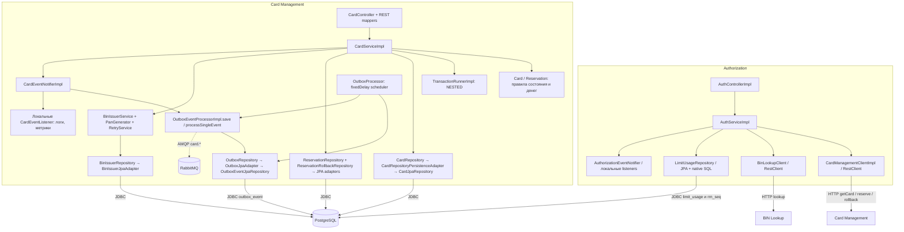

# А3. C4 Component — Authorization и Card Management

**Чего не хватало:** внутренних компонентов, транзакционных границ и мест для тестовых двойников.
**Что сделано:** контроллеры отделены от бизнес-логики, HTTP-клиентов, JPA/JDBC и outbox.
Сплошные связи — синхронные вызовы, пунктир — AMQP.

## Подтверждение и границы тестов

| Компоненты | Код | Выбор проверки |
|---|---|---|
| HTTP вход Authorization | [AuthControllerImpl.java](../../../services/authorization/src/main/java/com/processing/authorization/controller/AuthControllerImpl.java) | API: HTTP-статус и тело, AuthService подменяется |
| Авторизация | [AuthServiceImpl.java](../../../services/authorization/src/main/java/com/processing/authorization/services/AuthServiceImpl.java), [DeclineOutcome.java](../../../services/authorization/src/main/java/com/processing/authorization/constants/DeclineOutcome.java) | Unit: порядок проверок с mock клиентов и репозитория; SQL лимитов требует integration |
| HTTP зависимости | [CardManagementClientImpl.java](../../../services/authorization/src/main/java/com/processing/authorization/client/CardManagementClientImpl.java), [BinLookupClient.java](../../../services/authorization/src/main/java/com/processing/authorization/client/BinLookupClient.java) | API/контракт с HTTP stub; исключения клиента можно подать в unit |
| SQL лимитов | [LimitUsageRepository.java](../../../services/authorization/src/main/java/com/processing/authorization/repositories/LimitUsageRepository.java) | Integration с PostgreSQL, иначе native upsert не проверяется |
| Карты и резервы | [CardController.java](../../../services/card-management/src/main/java/com/processing/cardmanagement/controllers/CardController.java), [CardServiceImpl.java](../../../services/card-management/src/main/java/com/processing/cardmanagement/services/CardServiceImpl.java), [Card.java](../../../services/card-management/src/main/java/com/processing/cardmanagement/models/Card.java), [Reservation.java](../../../services/card-management/src/main/java/com/processing/cardmanagement/models/Reservation.java) | Unit доменных правил; API DTO; integration блокировок, сохранения и rollback |
| Persistence | [CardRepositoryPersistenceAdapter.java](../../../services/card-management/src/main/java/com/processing/cardmanagement/repositories/CardRepositoryPersistenceAdapter.java), [ReservationRepositoryPersistenceAdapter.java](../../../services/card-management/src/main/java/com/processing/cardmanagement/repositories/ReservationRepositoryPersistenceAdapter.java), [ReservationRollbackRepositoryPersistenceAdapter.java](../../../services/card-management/src/main/java/com/processing/cardmanagement/repositories/ReservationRollbackRepositoryPersistenceAdapter.java), [BinIssuerJpaAdapter.java](../../../services/card-management/src/main/java/com/processing/cardmanagement/repositories/BinIssuerJpaAdapter.java) | Реальная БД для проверки фильтров, ограничений, блокировок |
| Транзакции | [TransactionRunnerImpl.java](../../../services/card-management/src/main/java/com/processing/cardmanagement/services/TransactionRunnerImpl.java) | PATCH, DELETE, reserve и rollback вызывают обёртку; создание карты общей обёртки не имеет |
| События | [CardEventNotifierImpl.java](../../../services/card-management/src/main/java/com/processing/cardmanagement/events/CardEventNotifierImpl.java), [OutboxEventProcessorImpl.java](../../../services/card-management/src/main/java/com/processing/cardmanagement/services/OutboxEventProcessorImpl.java), [OutboxProcessor.java](../../../services/card-management/src/main/java/com/processing/cardmanagement/services/OutboxProcessor.java), [OutboxJpaAdapter.java](../../../services/card-management/src/main/java/com/processing/cardmanagement/repositories/OutboxJpaAdapter.java) | Unit счётчика ошибок; integration атомарности outbox и доставки |

`AuthorizationEventNotifier` и `CardEventNotifier` вызывают локальные listeners;
это не отдельные микросервисы и не сообщения RabbitMQ сами по себе.
Успешное `convertAndSend` переводит outbox в PROCESSED без ожидания consumer и confirm.
Scheduler выбирает PENDING с retryCount меньше предела; значение по умолчанию — 3 ошибки,
интервал — 1000 мс ([application.properties](../../../services/card-management/src/main/resources/application.properties)).
