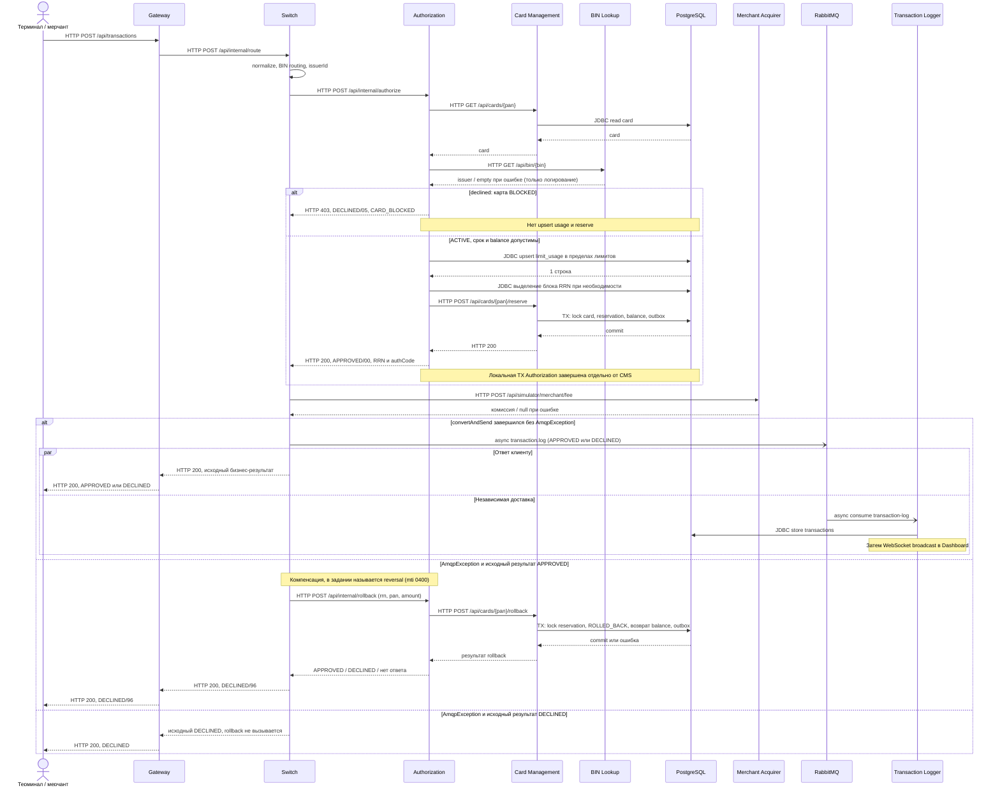

# А4. Sequence — успешная операция, отказ и компенсация

**Чего не хватало:** ветвей declined/reversal и точной границы async.
**Что сделано:** отражён порядок вызовов из RouteService/AuthServiceImpl, включая комиссию,
обновление usage до reserve и отдельный rollback. Пунктирные ответы HTTP не означают AMQP:
асинхронные сообщения здесь помечены явно и используют стрелку `-)`.

## Что не следует выводить из схемы

- Happy path предполагает допустимый BIN, ACTIVE-карту, достаточные баланс/лимиты и успешные зависимости.
- Сохранение Logger может завершиться до ответа клиенту или после: порядок между ними не гарантирован.
- Настройка correlated confirm не равна ожиданию ACK. Требование «нет confirm за 2s → rollback»
  в этой версии отсутствует: LoggerClient проверяет только исключение отправки.
- `AuthorizationRequest.forReversal(rrn)` создаёт MTI 0400, но не вызывается рабочим путём.
  Реальный rollback DTO содержит только rrn/pan/amount. Нельзя рисовать HTTP authorize(0400)
  как реализованный откат; проверка этого требования включена в новые кейсы.
- Ошибка rollback не меняет итоговый DECLINED/96, но деньги при ней могут остаться зарезервированы.
- `limit_usage` не компенсируется методом rollback. При ошибке reserve тоже нет явной компенсации.
- Запись APPROVED могла уйти в очередь даже при неопределённом исходе отправки;
  отдельное исправляющее сообщение ROLLED_BACK код не публикует.

## Источники

[application.yml](../../../services/gateway/src/main/resources/application.yml), [RouteController.java](../../../services/switch/src/main/java/com/processing/controller/RouteController.java), [RouteService.java](../../../services/switch/src/main/java/com/processing/service/RouteService.java),
[AuthorizationClient.java](../../../services/switch/src/main/java/com/processing/service/AuthorizationClient.java), [AuthControllerImpl.java](../../../services/authorization/src/main/java/com/processing/authorization/controller/AuthControllerImpl.java), [AuthServiceImpl.java](../../../services/authorization/src/main/java/com/processing/authorization/services/AuthServiceImpl.java), [DeclineOutcome.java](../../../services/authorization/src/main/java/com/processing/authorization/constants/DeclineOutcome.java),
[CardManagementClientImpl.java](../../../services/authorization/src/main/java/com/processing/authorization/client/CardManagementClientImpl.java), [CardServiceImpl.java](../../../services/card-management/src/main/java/com/processing/cardmanagement/services/CardServiceImpl.java), [LimitUsageRepository.java](../../../services/authorization/src/main/java/com/processing/authorization/repositories/LimitUsageRepository.java),
[MerchantAcquirerClient.java](../../../services/switch/src/main/java/com/processing/service/MerchantAcquirerClient.java), [LoggerClient.java](../../../services/switch/src/main/java/com/processing/service/LoggerClient.java), [TransactionLogListener.java](../../../services/transaction-logger/src/main/java/com/processing/transactionlogger/listener/TransactionLogListener.java), [TransactionService.java](../../../services/transaction-logger/src/main/java/com/processing/transactionlogger/service/TransactionService.java),
[AuthorizationRequest.java](../../../services/common/src/main/java/com/processing/common/dto/authorization/AuthorizationRequest.java), [RollbackRequest.java](../../../services/common/src/main/java/com/processing/common/dto/authorization/RollbackRequest.java), [application.yml](../../../services/switch/src/main/resources/application.yml).
