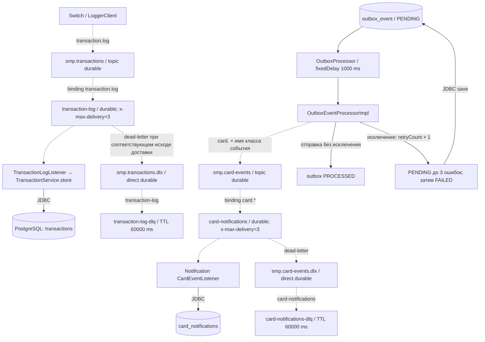

# А5. RabbitMQ — топология и обработка ошибок

**Чего не хватало:** графической карты двух каналов сообщений и разделения разных механизмов повторов.
**Что сделано:** показаны exchange, binding key, очередь, consumer, DLX/DLQ;
ожидание confirm и три доставки отмечены как непроверенные требования, а не гарантии кода.
Все пунктирные линии — асинхронное движение сообщений. Сплошные — локальный вызов/JDBC.

Последняя стрелка означает запись строки outbox: FAILED больше не выбирается scheduler.
События имеют реальные ключи, например `card.CardServicePatchEvent` и `card.CardServiceReserveEvent`.

| Механизм | Реализация | Проверка / ограничение |
|---|---|---|
| Publisher confirm | В Switch и CMS включён correlated | В отправителях нет CorrelationData, ожидания ACK/NACK или таймаута 2s; возврат convertAndSend не доказывает сохранение сообщения consumer |
| Switch rollback | LoggerClient ловит AmqpException и возвращает false | RouteService компенсирует только исходный APPROVED; negative confirm без исключения не обработан |
| Outbox retry | PENDING, retryCount < 3, fixedDelay 1000 ms | 3 ошибки обработки суммарно, затем FAILED; это не consumer retry и не exponential backoff |
| Consumer retry | Очередям передан x-max-delivery=3 | Явный listener retry/recoverer не найден. Три попытки и DLQ нужно проверять с реальным брокером; комментарий JavaDoc не является доказательством |
| DLQ TTL | 60000 ms на каждой DLQ | Время жизни диагностического сообщения, не задержка перед повтором. Обратного маршрута в основную очередь нет |
| Logger setup | Logger объявляет основной exchange/queue/binding | Transaction DLX и DLQ объявляет Switch; автономный тест Logger должен создать и эту часть топологии |

## Подтверждение кодом

- [RabbitMQConfig.java](../../../services/switch/src/main/java/com/processing/config/RabbitMQConfig.java) и [RabbitMQConfig.java](../../../services/transaction-logger/src/main/java/com/processing/transactionlogger/config/RabbitMQConfig.java) — транзакционный канал.
- [RabbitMQConfig.java](../../../services/card-management/src/main/java/com/processing/cardmanagement/config/RabbitMQConfig.java) и [RabbitMQConfig.java](../../../services/notification-service/src/main/java/com/processing/notification/config/RabbitMQConfig.java) — карточный канал.
- [LoggerClient.java](../../../services/switch/src/main/java/com/processing/service/LoggerClient.java), [RouteService.java](../../../services/switch/src/main/java/com/processing/service/RouteService.java), [application.yml](../../../services/switch/src/main/resources/application.yml) — отправка/ошибка/конфигурация confirms.
- [OutboxProcessor.java](../../../services/card-management/src/main/java/com/processing/cardmanagement/services/OutboxProcessor.java), [OutboxEventProcessorImpl.java](../../../services/card-management/src/main/java/com/processing/cardmanagement/services/OutboxEventProcessorImpl.java), [OutboxJpaAdapter.java](../../../services/card-management/src/main/java/com/processing/cardmanagement/repositories/OutboxJpaAdapter.java), [application.properties](../../../services/card-management/src/main/resources/application.properties) — polling и retry outbox.
- [TransactionLogListener.java](../../../services/transaction-logger/src/main/java/com/processing/transactionlogger/listener/TransactionLogListener.java), [CardEventListener.java](../../../services/notification-service/src/main/java/com/processing/notification/listener/CardEventListener.java), [application.yaml](../../../services/transaction-logger/src/main/resources/application.yaml), [application.yml](../../../services/notification-service/src/main/resources/application.yml) — consumers и отсутствие явной retry-конфигурации в этих файлах.

Для integration нужны отдельный RabbitMQ и PostgreSQL; проверять eventual consistency следует polling с ограниченным временем, а не немедленным SELECT или фиксированным sleep.
