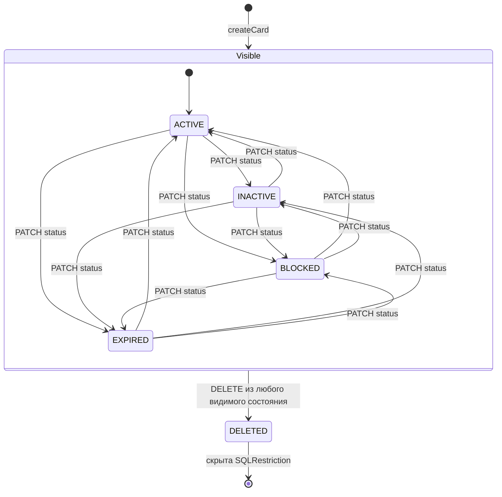

# А6. State-transition — карта и результат транзакции

**Чего не хватало:** явных переходов и разделения статуса ответа и состояния резерва.
**Что сделано:** добавлены DELETED, реальные PATCH-переходы и компенсация как изменение Reservation.
Состояния процесса на второй схеме не объявляются значениями TransactionStatus.

## Card.status

`patchCard` не задаёт таблицу запрещённых переходов между четырьмя публичными статусами;
повторный PATCH того же статуса сохраняет состояние. Генератор создаёт карты также в других статусах.
Переход EXPIRED → ACTIVE через PATCH не продлевает expiryDate.
Истечение календарного срока само по себе не меняет Card.status: Authorization сравнивает
конец expiryDate с UTC-датой `transmissionDateTime` и отклоняет операцию с 54.
Для не-ACTIVE `Card.startReservation` запрещает резервирование; HTTP GET карту при этом допускает.
DELETED — внутренний статус soft delete, скрываемый Hibernate SQLRestriction.

## Жизненный цикл обработки транзакции и резерва

```mermaid
stateDiagram-v2
    [*] --> Checking
    Checking --> DECLINED: неизвестный BIN / карта / статус / expiry / balance / лимит / ошибка
    Checking --> APPROVED: usage обновлён и reserve успешен
    APPROVED --> ReturnedApproved: publish без AmqpException
    APPROVED --> Compensating: publish вернул false
    Compensating --> ROLLED_BACK: CMS rollback успешен
    Compensating --> RollbackUncertain: rollback отклонён или нет ответа
    ROLLED_BACK --> ReturnedDeclined96: ответ клиенту
    RollbackUncertain --> ReturnedDeclined96: ответ клиенту тот же
    DECLINED --> ReturnedDeclined: попытка публикации; rollback не нужен
    ReturnedApproved --> [*]
    ReturnedDeclined --> [*]
    ReturnedDeclined96 --> [*]
```

- APPROVED/DECLINED — два значения [TransactionStatus.java](../../../services/common/src/main/java/com/processing/common/dto/transactionlogger/TransactionStatus.java).
- ROLLED_BACK на схеме — результат компенсации **резерва**, значение [ReservationStatus.java](../../../services/card-management/src/main/java/com/processing/cardmanagement/models/ReservationStatus.java).
  Изначально резерв RESERVED; `Reservation.rolledBack` меняет его на ROLLED_BACK,
  `Card.withRollback` возвращает сумму. Повторный rollback выбрасывает RollbackAlreadySatisfiedException.
- Logger сохраняет построенный до компенсации TransactionRequest, а не весь этот автомат;
  перехода persisted Transaction APPROVED → ROLLED_BACK в коде нет.
- `ReturnedDeclined96` не доказывает успешную компенсацию. `limit_usage` при rollback не уменьшается.
- Reversal MTI 0400 присутствует как helper DTO, но компенсационный путь использует отдельный HTTP rollback (см. А4).

## Источники

[CardStatus.java](../../../services/card-management/src/main/java/com/processing/cardmanagement/models/CardStatus.java), [CardModelStatus.java](../../../services/common/src/main/java/com/processing/common/dto/cardmanagement/CardModelStatus.java), [CardStatusMapper.java](../../../services/card-management/src/main/java/com/processing/cardmanagement/mappers/CardStatusMapper.java), [Card.java](../../../services/card-management/src/main/java/com/processing/cardmanagement/models/Card.java), [CardEntity.java](../../../services/card-management/src/main/java/com/processing/cardmanagement/models/CardEntity.java),
[CardServiceImpl.java](../../../services/card-management/src/main/java/com/processing/cardmanagement/services/CardServiceImpl.java), [CardController.java](../../../services/card-management/src/main/java/com/processing/cardmanagement/controllers/CardController.java), [AuthServiceImpl.java](../../../services/authorization/src/main/java/com/processing/authorization/services/AuthServiceImpl.java), [Reservation.java](../../../services/card-management/src/main/java/com/processing/cardmanagement/models/Reservation.java),
[ReservationStatus.java](../../../services/card-management/src/main/java/com/processing/cardmanagement/models/ReservationStatus.java), [TransactionStatus.java](../../../services/common/src/main/java/com/processing/common/dto/transactionlogger/TransactionStatus.java), [RouteService.java](../../../services/switch/src/main/java/com/processing/service/RouteService.java), [AuthorizationClient.java](../../../services/switch/src/main/java/com/processing/service/AuthorizationClient.java), [TransactionService.java](../../../services/transaction-logger/src/main/java/com/processing/transactionlogger/service/TransactionService.java).
